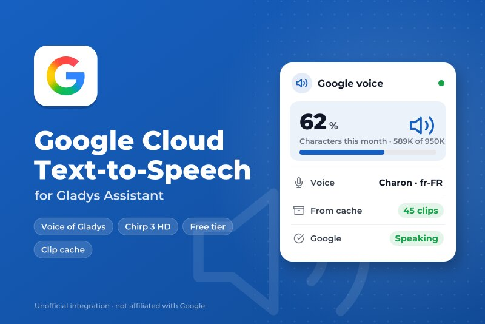
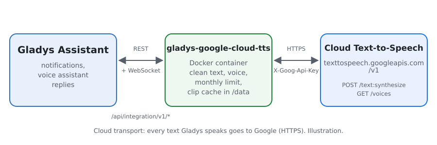
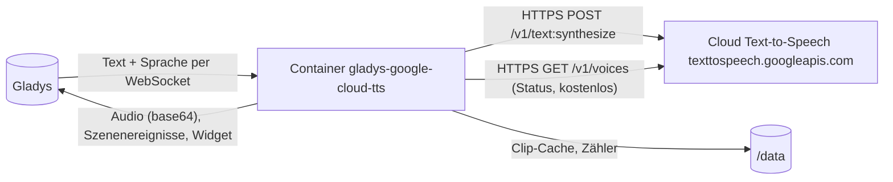
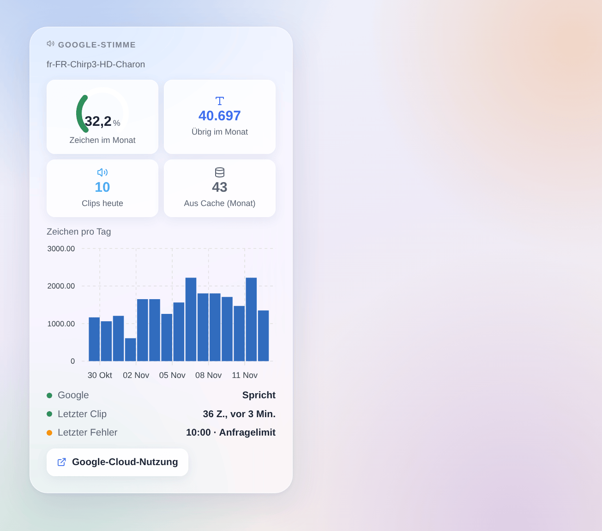

# Gladys Google Cloud Text-to-Speech

[English](README.md) · [Français](README.fr.md) · **Deutsch** · [Español](README.es.md)

[](LICENSE)
[](https://github.com/William-De71/gladys-google-cloud-tts/releases)
[](https://github.com/William-De71/gladys-google-cloud-tts/actions/workflows/release.yml)
[](https://gladysassistant.com)



Externe Integration für [Gladys Assistant](https://gladysassistant.com), die Gladys eine **Google-Cloud-Stimme** gibt — Chirp 3 HD, Neural2, WaveNet… — über die offizielle Cloud Text-to-Speech API und deinen eigenen API-Schlüssel. Als Stimme unter Einstellungen → Künstliche Intelligenz gewählt, spricht sie die Benachrichtigungen der Szenen auf deinen Lautsprechern und die Antworten des Sprachassistenten, in der Sprache jedes Benutzers, unter einem monatlichen Zeichenlimit, das dich standardmäßig im kostenlosen Kontingent hält.

Benutzerdokumentation: [English](docs/en.md) · [Français](docs/fr.md) · [Deutsch](docs/de.md) · [Español](docs/es.md).

Nicht mit Google verbunden. **Noch nicht mit einem echten Google-Cloud-Schlüssel getestet**: Die Anfragen folgen der offiziellen API-Referenz, und die Tests laufen gegen eine gefälschte API. Rückmeldungen sind willkommen.

## Funktionen

- **TTS-Anbieter** (`type: "tts"`, Gladys 5.3+): Die Szenenaktion „Benachrichtigung abspielen“ und der Sprachassistent sprechen mit einer Google-Stimme.
- **Eine Stimme pro Sprache**: Gladys gibt die Sprache des Benutzers an; die Integration wählt eine Stimme der gewählten Familie (Chirp 3 HD, Neural2, WaveNet, Standard, Studio, Polyglot) und des gewählten Geschlechts, immer dieselbe — oder die für diese Sprache per Name eingegebene Stimme.
- **Klangeinstellungen**: Geschwindigkeit, Tonhöhe, Lautstärkeanhebung, Geräteprofil (Lautsprecher, HiFi, Kopfhörer…), MP3, Ogg Opus oder WAV.
- **Kosten im Griff**: ein monatliches Zeichenlimit (standardmäßig 95 % des kostenlosen Kontingents), vor jedem Clip geprüft; ein Clip-Cache (300 Clips), damit ein schon gesprochener Satz nie erneut berechnet wird; Markdown und Emoji werden vor dem Senden entfernt.
- **Szenenauslöser**: Sprachausgabe schlägt fehl (Schlüssel abgelehnt, API oder Abrechnung nicht aktiviert, Stimme unbekannt, API nicht erreichbar), spricht wieder, und 80 % / 100 % des Monatslimits.
- **Dashboard-Widget**: Zeichen des Monats im Vergleich zum Limit, Clips des Tages und aus dem Cache, Zeichen pro Tag, letzter Clip und letzter Fehler.
- Schaltflächen **Stimme testen**, **Stimmen auflisten** und **Clip-Cache leeren**. Englisch, Französisch, Deutsch und Spanisch.

## Funktionsweise





Eine Benachrichtigung, von der Szene zum Lautsprecher:

```mermaid
sequenceDiagram
  participant S as Szene
  participant G as Gladys
  participant I as Integration
  participant T as Google
  S->>G: Benachrichtigung abspielen „Das Garagentor ist offen“
  G->>I: synthesize(Text, "de")
  I->>I: Text bereinigen, de-DE-Chirp3-HD-Achernar wählen
  alt schon mit denselben Einstellungen gesprochen
    I->>I: aus dem Clip-Cache lesen (nichts berechnet)
  else neuer Satz, unter dem Monatslimit
    I->>T: text:synthesize (Stimme, Audioeinstellungen)
    T-->>I: MP3 (base64)
    I->>I: Zeichen zählen, Clip aufbewahren
  end
  I-->>G: audio/mpeg;base64,…
  G->>G: Clip über eine einmalige LAN-URL bereitstellen
  G->>S: der Lautsprecher spielt ihn ab
```

Gladys kürzt einen Text auf 2.000 Zeichen und wartet 30 s auf den Clip; die Integration gibt Google 25 s, wiederholt einen 429 oder 5xx innerhalb dieser Zeit und hält jede Anfrage unter den 5.000 Bytes, die Google annimmt. Ein Fehler wird nie versteckt: Die Szenenaktion schlägt sichtbar fehl, und der Sprachassistent antwortet schriftlich.

### Transport

`transports: ["cloud"]`: Alles geht per HTTPS an `texttospeech.googleapis.com`, der Schlüssel im Header `X-Goog-Api-Key`. **Google erhält jeden Text, den Gladys vorliest** (Benachrichtigungen, Antworten des Assistenten). `/data` enthält die Zähler und den Clip-Cache (300 Clips, höchstens 40 MB); sonst verlässt nichts den Container.

## Stimmen

| Familie    | Jeden Monat kostenlos      | Danach, pro Million | Hinweise                                  |
| ---------- | -------------------------- | ------------------- | ----------------------------------------- |
| Chirp 3 HD | 1 Million                  | 30 $                | Standard: am natürlichsten; keine Tonhöhe |
| Neural2    | 1 Million (mit Polyglot)   | 16 $                | Natürlich, viele Sprachen                 |
| WaveNet    | 4 Millionen (mit Standard) | 4 $                 | Gut, fast alle Sprachen                   |
| Standard   | 4 Millionen (mit WaveNet)  | 4 $                 | Roboterhaft, alle Sprachen                |
| Studio     | 1 Million                  | 160 $               | Erzählung, wenige Sprachen; keine Tonhöhe |
| Polyglot   | 1 Million (mit Neural2)    | 16 $                | Vorschau, wenige Sprachen                 |

Preise am 9. November 2026 auf cloud.google.com/text-to-speech/pricing geprüft; Gemini-TTS-Stimmen (pro Token abgerechnet, ohne kostenloses Kontingent) werden nicht angeboten. Hat die Familie keine Stimme für eine Sprache, werden Chirp 3 HD, Neural2, WaveNet und dann Standard versucht, und die Konfigurationsseite meldet es.

## Szenen und Widget



- **Auslöser „Google-Stimme: Sprachausgabe schlägt fehl“**: Variablen `kind` (`auth`, `disabled`, `billing`, `voice`, `rate_limit`, `unreachable`, `timeout`, `server`), `message`, `voice`, `language`; Filter nach Art. Einmal pro Ausfall. Ein einzeln abgelehnter Text und das Monatslimit lösen hier nichts aus.
- **Auslöser „Google-Stimme: spricht wieder“**: Variable `down_minutes`.
- **Auslöser „Google-Stimme: Monatslimit“**: Variablen `level` (`warning` bei 80 %, `reached`, wenn ein Clip abgelehnt wird), `used`, `limit`, `percent`, `month`; einmal pro Stufe und Abrechnungsmonat.
- **Widget „Google-Stimme“**: von der Integration gezählt; derselbe Schlüssel anderswo genutzt ist nicht enthalten. Die Google-Cloud-Konsole bleibt die Referenz für die Rechnung.
- **Keine Szenenaktion**: Das Audio spielt Gladys selbst ab („Benachrichtigung abspielen“); ein Clip ist keine Ausgabe, die eine Szene nutzen könnte.

Beispiele:

- _Wenn die Sprachausgabe fehlschlägt_ (Art `billing`) → dem Administrator eine Telegram-Nachricht mit `{{triggerEvent.data.message}}` schicken.
- _Wenn das Monatslimit 80 % erreicht_ → eine E-Mail „Google-Stimme: `{{triggerEvent.data.percent}}` % des Monats verbraucht“ schicken.

## Voraussetzungen

- Gladys Assistant **5.3.0** oder neuer (TTS-Anbieter); ältere Instanzen können die Integration nicht installieren.
- Ein Google-Cloud-Projekt mit aktivierter Abrechnung, aktivierter Cloud Text-to-Speech API und einem auf diese API beschränkten API-Schlüssel.

### Kosten und Limits

- **Abrechnung pro Zeichen**, Leerzeichen inklusive, pro Kalendermonat des Rechnungskontos (pazifische Zeit). Google verlangt ein Rechnungskonto auch innerhalb des kostenlosen Kontingents.
- **Das Monatslimit** der Integration beträgt standardmäßig 95 % des kostenlosen Kontingents der gewählten Familie (950.000 Zeichen für Chirp 3 HD). Es zählt nur, was diese Integration sendet: Spricht dasselbe Projekt auch anderswo, senke es oder lege in der Google-Cloud-Konsole eine Budgetwarnung fest.
- **Anfragelimits**: 200 pro Minute für Chirp 3 HD, 1.000 für die anderen — weit über dem Bedarf eines Zuhauses.

## Installation

- **Aus dem Store**: Integrationen → Google Cloud Text-to-Speech → Installieren.
- **Über die URL des Repositorys**: Integrationen → externe Integration → `https://github.com/William-De71/gladys-google-cloud-tts`.
- **Entwicklermodus**: Starte `npm start` mit den von Gladys gegebenen Variablen (siehe Entwicklung).

## Konfiguration

| Feld oder Schaltfläche             | Standard    | Bedeutung                                                                      |
| ---------------------------------- | ----------- | ------------------------------------------------------------------------------ |
| API-Schlüssel                      | —           | Pflichtfeld, ein Geheimnis: nie wieder angezeigt, nie protokolliert            |
| Stimmenfamilie                     | Chirp 3 HD  | Siehe Stimmen                                                                  |
| Geschlecht der Stimme              | Weiblich    | Die in der Familie gewählte Stimme, für jede Sprache                           |
| Stimmen nach Name                  | —           | Optional, eine pro Sprache, durch Kommas getrennt: `de-DE-Chirp3-HD-Charon, …` |
| Sprache, wenn unbekannt            | Englisch    | Wenn Gladys die Sprache nicht angibt                                           |
| Geschwindigkeit, Tonhöhe, Anhebung | 1×, 0, 0 dB | Auswahllisten; Chirp 3 HD und Studio ignorieren die Tonhöhe                    |
| Optimiert für                      | —           | Google-Audioprofil des Geräts, das die Stimme abspielt                         |
| Audioformat                        | MP3         | MP3, Ogg Opus oder WAV (höchstens 5 MB: kurze Texte)                           |
| Monatslimit                        | 0           | Zeichen pro Monat; 0 = 95 % des kostenlosen Kontingents der Familie            |
| Stimme testen                      | —           | Spricht einen kurzen Satz, zeigt Stimme, Dauer und Monat                       |
| Stimmen auflisten                  | —           | Die Stimmen der Familie für eine Sprache (kostenlos)                           |
| Clip-Cache leeren                  | —           | Vergisst die schon gesprochenen Sätze                                          |

## Verwendung

1. In Gladys (Integrationen → Google Cloud Text-to-Speech → Konfiguration): Füge den API-Schlüssel ein, wähle Familie und Geschlecht; drücke **Stimme testen**.
2. Einstellungen → **Künstliche Intelligenz**, Karte **Stimme**: Wähle **Google Cloud Text-to-Speech**.
3. Nutze „Benachrichtigung abspielen“ in deinen Szenen; füge das Widget einem Dashboard hinzu; nutze die Auslöser.

## Entwicklung

```bash
npm install
npm test                       # node --test, eine gefälschte Google-API auf 127.0.0.1, nie das Netzwerk
npm run lint                   # ESLint
npm run format:check           # Prettier
npx github:GladysAssistant/integration-store . --skip-image-check
scripts/build-cover.sh         # cover.jpg aus docs/assets/cover.svg
docs/illustrations/render.sh   # docs/assets/widgets.<lang>.png
```

Lokal liest das SDK `GLADYS_HOST_API_URL`, `GLADYS_INTEGRATION_TOKEN` und `GLADYS_INTEGRATION_SELECTOR` (von Gladys im Entwicklermodus vorgegeben), und die Integration liest `TZ`. `DEBUG=gladys-integration-sdk` zeigt die Protokolle des SDK.

Die Tests decken den HTTP-Client ab (Fehlerarten aus dem `ErrorInfo` von Google, Wiederholungen, Fristen, maskierte Schlüssel), die Bereinigung des Textes und den Schnitt bei 5.000 Bytes, die Wahl der Stimme, den Clip-Cache, das Monatslimit und seinen Abrechnungsmonat, die Auslöser, das Widget (`validateWidgetContent`), das Manifest, die vier Sprachen, das Release-Skript und die ganze Integration gegen das gefälschte Gladys des SDK. `test/structure.test.js` friert jeden von Benutzern gespeicherten Schlüssel ein.

## Release-Prozess


Jeder Merge auf `main` startet die CI und berechnet dann die Version aus den [Conventional Commits](https://www.conventionalcommits.org/) seit dem letzten Tag: `feat` → Minor, `fix` / `perf` → Patch, `!` oder `BREAKING CHANGE` → Major (ein Minor unter 1.0.0); `docs`, `chore`, `ci`, `test`, `style`, `refactor`, `build` allein veröffentlichen nichts. Der Changelog-Abschnitt wird erzeugt, der Tag gepusht, das Multi-Architektur-Image gebaut, dann erhält `main` den Release-Commit, das GitHub Release wird erstellt und ein letzter Job prüft das öffentliche Image, den Validator des Stores und das Topic.

- Der Titel des Pull Requests wird zum Squash-Commit und dann zur Changelog-Zeile: Schreibe ihn auf Englisch, für den Benutzer (`pr-title.yml` prüft ihn). Bearbeite `CHANGELOG.md` nie von Hand.
- 1.0.0 ist eine Entscheidung: Actions → Release → Run workflow mit `release-as: 1.0.0`. `dry-run` zeigt Version und Notizen, ohne zu veröffentlichen.
- **Geschützter Branch**: Rulesets verlangen einen Pull Request auf `main` und sperren die `v*`-Tags; nur der Maintainer und Deploy Keys kommen durch. Das Release pusht mit dem Deploy Key der Umgebung `release` (Secret `RELEASE_DEPLOY_KEY`, nur `main`): Ein Lauf von einem anderen Branch erhält ihn nie. `build.yml` und `github-release.yml` starten nicht bei einem Tag: Das Release ruft sie auf, oder starten Sie sie von Hand (Actions → Run workflow, mit `version` für das Image), um ein Release abzuschließen.
- Mache nach dem ersten Release das Paket auf `ghcr.io` öffentlich (Package settings → Change visibility), sonst kann Gladys es nicht herunterladen.

## Fehlerbehebung

Siehe [docs/de.md](docs/de.md#fehlerbehebung). Melde Probleme mit den Versionen von Gladys und der Integration, der Stimmenfamilie, dem Audioformat, dem Lautsprecher und der Meldung von **Stimme testen**. Füge niemals deinen API-Schlüssel ein.

## Mitwirken

Issues und Pull Requests sind willkommen, vor allem von Leuten mit einem Google-Cloud-Schlüssel: Eine fehlschlagende Anfrage (ohne den Schlüssel) hilft sehr. Führe vor einem Pull Request `npm run format:check && npm run lint && npm test` aus und lass jeden gespeicherten Schlüssel unverändert (siehe [CLAUDE.md](CLAUDE.md)).

## Sicherheit

Siehe [SECURITY.md](SECURITY.md): Melde Sicherheitslücken vertraulich. Der API-Schlüssel ist ein Feld vom Typ `secret`: nie protokolliert, nie in `/data` geschrieben, nur per HTTPS in einem Header an `texttospeech.googleapis.com` gesendet; ein in einer Fehlermeldung zitierter Schlüssel wird maskiert.

## Kommende Screenshots

Die Bilder oben sind Illustrationen, keine Screenshots. Echte Screenshots kommen nach `docs/assets/screenshots/` (PNG, 1280 × 800): `configuration.png` (die Konfiguration mit ihrem Status und dem Ergebnis von Stimme testen), `ai-settings.png` (Google Cloud Text-to-Speech in der Karte Stimme unter Einstellungen → Künstliche Intelligenz gewählt), `scene.png` (eine Szene „Benachrichtigung abspielen“).

## Lizenz

[Apache License 2.0](LICENSE) — siehe auch [NOTICE](NOTICE). Google, Google Cloud und das Google-Logo sind Marken von Google LLC; dieses Projekt ist nicht mit Google verbunden und wird von Google weder unterstützt noch gesponsert. Danke an die Dokumentation und das SDK von Gladys sowie an die Dokumentation von Cloud Text-to-Speech.
