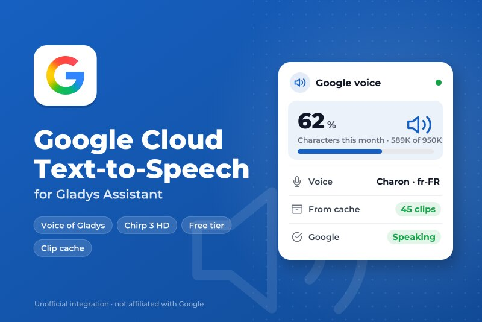
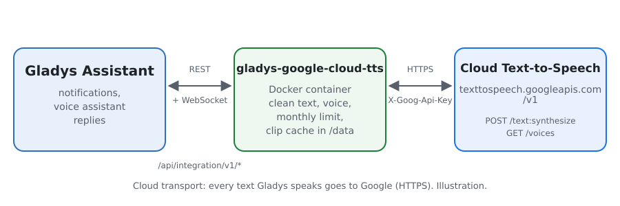
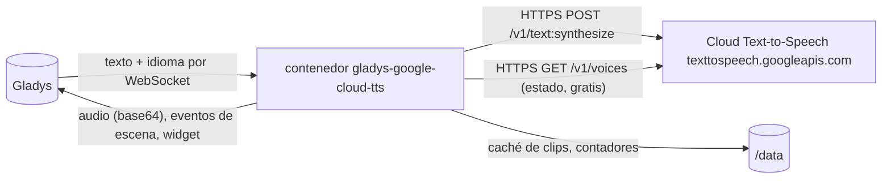
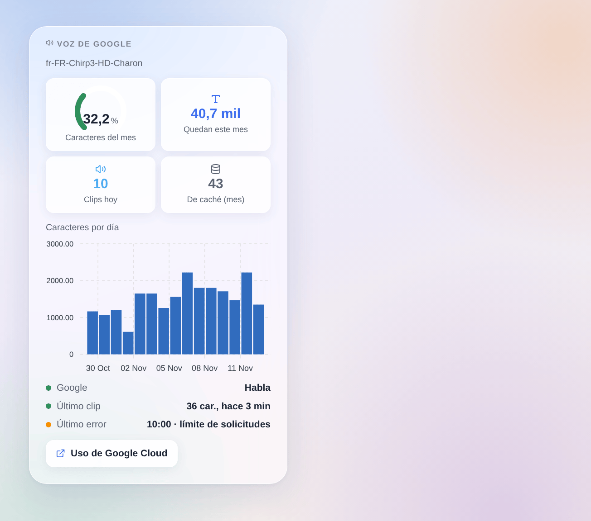

# Gladys Google Cloud Text-to-Speech

[English](README.md) · [Français](README.fr.md) · [Deutsch](README.de.md) · **Español**

[](LICENSE)
[](https://github.com/William-De71/gladys-google-cloud-tts/releases)
[](https://github.com/William-De71/gladys-google-cloud-tts/actions/workflows/release.yml)
[](https://gladysassistant.com)



Integración externa para [Gladys Assistant](https://gladysassistant.com) que da a Gladys una **voz de Google Cloud** — Chirp 3 HD, Neural2, WaveNet… — a través de la API oficial Cloud Text-to-Speech y su propia clave de API. Elegida como voz en Ajustes → Inteligencia artificial, pronuncia las notificaciones de las escenas en sus altavoces y las respuestas del asistente de voz, en el idioma de cada usuario, bajo un límite mensual de caracteres que por defecto le mantiene dentro de la cuota gratuita.

Documentación de usuario: [English](docs/en.md) · [Français](docs/fr.md) · [Deutsch](docs/de.md) · [Español](docs/es.md).

No afiliada a Google. **Todavía no probada con una clave real de Google Cloud**: las solicitudes siguen la referencia oficial de la API, y las pruebas se ejecutan contra una API falsa. Sus comentarios son bienvenidos.

## Funciones

- **Proveedor TTS** (`type: "tts"`, Gladys 5.3+): la acción de escena «reproducir una notificación» y el asistente de voz hablan con una voz de Google.
- **Una voz por idioma**: Gladys indica el idioma del usuario; la integración elige una voz de la familia (Chirp 3 HD, Neural2, WaveNet, Standard, Studio, Polyglot) y del género elegidos, siempre la misma — o la voz escrita por su nombre para ese idioma.
- **Ajustes de sonido**: velocidad, tono, ganancia de volumen, perfil de dispositivo (altavoz, alta fidelidad, auriculares…), MP3, Ogg Opus o WAV.
- **Costes bajo control**: un límite mensual de caracteres (95 % de la cuota gratuita por defecto), comprobado antes de cada clip; una caché de clips (300 clips) para que una frase ya pronunciada nunca se vuelva a facturar; Markdown y emoji eliminados antes del envío.
- **Disparadores de escena**: el habla falla (clave rechazada, API o facturación no habilitada, voz desconocida, API inaccesible), vuelve a hablar, y 80 % / 100 % del límite mensual.
- **Widget del panel**: caracteres del mes frente al límite, clips del día y de la caché, caracteres por día, último clip y último error.
- Botones **Probar la voz**, **Listar las voces** y **Vaciar la caché de clips**. Inglés, francés, alemán y español.

## Funcionamiento





Una notificación, de la escena al altavoz:

```mermaid
sequenceDiagram
  participant S as Escena
  participant G as Gladys
  participant I as Integración
  participant T as Google
  S->>G: reproducir una notificación «La puerta del garaje está abierta»
  G->>I: synthesize(texto, "es")
  I->>I: limpia el texto, elige es-ES-Chirp3-HD-Achernar
  alt ya pronunciada con los mismos ajustes
    I->>I: lee la caché de clips (nada facturado)
  else frase nueva, bajo el límite mensual
    I->>T: text:synthesize (voz, ajustes de audio)
    T-->>I: MP3 (base64)
    I->>I: cuenta los caracteres, guarda el clip
  end
  I-->>G: audio/mpeg;base64,…
  G->>G: sirve el clip en una URL local de un solo uso
  G->>S: el altavoz lo reproduce
```

Gladys corta un texto a 2000 caracteres y espera el clip 30 s; la integración da 25 s a Google, reintenta un 429 o un 5xx dentro de ese plazo y mantiene cada solicitud por debajo de los 5000 bytes que acepta Google. Un fallo nunca se oculta: la acción de escena falla de forma visible, y el asistente de voz responde por escrito.

### Transporte

`transports: ["cloud"]`: todo va a `texttospeech.googleapis.com` por HTTPS, la clave en el encabezado `X-Goog-Api-Key`. **Google recibe cada texto que Gladys lee en voz alta** (notificaciones, respuestas del asistente). `/data` guarda los contadores y la caché de clips (300 clips, 40 MB como máximo); nada más sale del contenedor.

## Voces

| Familia    | Gratis cada mes           | Después, por millón | Notas                                 |
| ---------- | ------------------------- | ------------------- | ------------------------------------- |
| Chirp 3 HD | 1 millón                  | 30 $                | Por defecto: la más natural; sin tono |
| Neural2    | 1 millón (con Polyglot)   | 16 $                | Natural, muchos idiomas               |
| WaveNet    | 4 millones (con Standard) | 4 $                 | Buena, casi todos los idiomas         |
| Standard   | 4 millones (con WaveNet)  | 4 $                 | Robótica, todos los idiomas           |
| Studio     | 1 millón                  | 160 $               | Narración, pocos idiomas; sin tono    |
| Polyglot   | 1 millón (con Neural2)    | 16 $                | Versión preliminar, pocos idiomas     |

Precios comprobados en cloud.google.com/text-to-speech/pricing el 9 de noviembre de 2026; las voces Gemini-TTS (facturadas por token, sin cuota gratuita) no se ofrecen. Si la familia no tiene voz para un idioma, se prueban Chirp 3 HD, Neural2, WaveNet y luego Standard, y la pantalla de configuración lo indica.

## Escenas y widget



- **Disparador «Voz de Google: el habla falla»**: variables `kind` (`auth`, `disabled`, `billing`, `voice`, `rate_limit`, `unreachable`, `timeout`, `server`), `message`, `voice`, `language`; filtro por tipo. Una vez por fallo. Un texto rechazado por sí solo y el límite del mes no disparan nada aquí.
- **Disparador «Voz de Google: vuelve a hablar»**: variable `down_minutes`.
- **Disparador «Voz de Google: límite del mes»**: variables `level` (`warning` al 80 %, `reached` cuando se rechaza un clip), `used`, `limit`, `percent`, `month`; una vez por nivel y mes de facturación.
- **Widget «Voz de Google»**: contado por la integración; la misma clave usada en otro lugar no aparece. La consola de Google Cloud sigue siendo la referencia para la factura.
- **Sin acción de escena**: el audio lo reproduce la propia Gladys («reproducir una notificación»); un clip no es una salida que una escena pueda usar.

Ejemplos:

- _Cuando el habla falla_ (tipo `billing`) → enviar un mensaje de Telegram al administrador con `{{triggerEvent.data.message}}`.
- _Cuando el límite mensual llega al 80 %_ → enviar un correo «Voz de Google: `{{triggerEvent.data.percent}}` % del mes usado».

## Requisitos

- Gladys Assistant **5.3.0** o posterior (proveedores TTS); las instancias más antiguas no pueden instalar la integración.
- Un proyecto de Google Cloud con la facturación habilitada, la API Cloud Text-to-Speech habilitada y una clave de API restringida a esa API.

### Costes y límites

- **Facturación por carácter**, espacios incluidos, por mes natural de la cuenta de facturación (hora del Pacífico). Google exige una cuenta de facturación incluso dentro de la cuota gratuita.
- **El límite mensual** de la integración es por defecto el 95 % de la cuota gratuita de la familia elegida (950 000 caracteres para Chirp 3 HD). Solo cuenta lo que envía esta integración: si el mismo proyecto habla en otro lugar, bájelo, o configure una alerta de presupuesto en la consola de Google Cloud.
- **Límites de solicitudes**: 200 por minuto para Chirp 3 HD, 1000 para las demás — muy por encima de lo que necesita una casa.

## Instalación

- **Desde la tienda**: Integraciones → Google Cloud Text-to-Speech → Instalar.
- **Desde la URL del repositorio**: Integraciones → integración externa → `https://github.com/William-De71/gladys-google-cloud-tts`.
- **Modo desarrollador**: ejecute `npm start` con las variables que da Gladys (ver Desarrollo).

## Configuración

| Campo o botón             | Por defecto | Función                                                                    |
| ------------------------- | ----------- | -------------------------------------------------------------------------- |
| Clave de API              | —           | Obligatoria, un secreto: nunca se vuelve a mostrar, nunca se registra      |
| Familia de voces          | Chirp 3 HD  | Ver Voces                                                                  |
| Género de la voz          | Femenina    | La voz elegida en la familia, para cada idioma                             |
| Voces por nombre          | —           | Opcional, una por idioma, separadas por comas: `es-ES-Chirp3-HD-Charon, …` |
| Idioma si se desconoce    | Inglés      | Cuando Gladys no indica el idioma                                          |
| Velocidad, tono, ganancia | 1×, 0, 0 dB | Listas; Chirp 3 HD y Studio ignoran el tono                                |
| Optimizada para           | —           | Perfil de audio de Google del dispositivo que reproduce la voz             |
| Formato de audio          | MP3         | MP3, Ogg Opus o WAV (5 MB como máximo: textos cortos)                      |
| Límite mensual            | 0           | Caracteres al mes; 0 = 95 % de la cuota gratuita de la familia             |
| Probar la voz             | —           | Pronuncia una frase corta, muestra la voz, el tiempo y el mes              |
| Listar las voces          | —           | Las voces de la familia para un idioma (gratis)                            |
| Vaciar la caché de clips  | —           | Olvida las frases ya pronunciadas                                          |

## Uso

1. En Gladys (Integraciones → Google Cloud Text-to-Speech → Configuración): pegue la clave de API, elija la familia y el género; pulse **Probar la voz**.
2. Ajustes → **Inteligencia artificial**, tarjeta **Voz**: elija **Google Cloud Text-to-Speech**.
3. Use «reproducir una notificación» en sus escenas; añada el widget a un panel; use los disparadores.

## Desarrollo

```bash
npm install
npm test                       # node --test, una API de Google falsa en 127.0.0.1, nunca la red
npm run lint                   # ESLint
npm run format:check           # Prettier
npx github:GladysAssistant/integration-store . --skip-image-check
scripts/build-cover.sh         # cover.jpg a partir de docs/assets/cover.svg
docs/illustrations/render.sh   # docs/assets/widgets.<lang>.png
```

En local, el SDK lee `GLADYS_HOST_API_URL`, `GLADYS_INTEGRATION_TOKEN` y `GLADYS_INTEGRATION_SELECTOR` (que da Gladys en modo desarrollador), y la integración lee `TZ`. `DEBUG=gladys-integration-sdk` muestra los registros del SDK.

Las pruebas cubren el cliente HTTP (tipos de error a partir del `ErrorInfo` de Google, reintentos, plazos, claves ocultas), la limpieza del texto y el corte a 5000 bytes, la elección de la voz, la caché de clips, el límite mensual y su mes de facturación, los disparadores, el widget (`validateWidgetContent`), el manifiesto, los cuatro idiomas, el script de release y toda la integración contra el Gladys falso del SDK. `test/structure.test.js` congela cada clave que guardan los usuarios.

## Proceso de release


Cada fusión en `main` lanza la CI y luego calcula la versión a partir de los [Conventional Commits](https://www.conventionalcommits.org/) desde la última etiqueta: `feat` → menor, `fix` / `perf` → parche, `!` o `BREAKING CHANGE` → mayor (una menor por debajo de 1.0.0); `docs`, `chore`, `ci`, `test`, `style`, `refactor`, `build` solos no publican nada. Se genera la sección del changelog, se sube la etiqueta, se construye la imagen multiarquitectura, luego `main` recibe el commit de release, se crea la GitHub Release y un último job comprueba la imagen pública, el validador de la tienda y el topic.

- El título de la pull request se convierte en el commit squash y luego en la línea del changelog: escríbalo en inglés, para el usuario (`pr-title.yml` lo comprueba). Nunca edite `CHANGELOG.md` a mano.
- 1.0.0 es una decisión: Actions → Release → Run workflow con `release-as: 1.0.0`. `dry-run` muestra la versión y las notas sin publicar nada.
- **Rama protegida**: la release sube su commit a `main` con `GITHUB_TOKEN`. El ruleset `protect-main` (sin borrado ni force-push) lo deja pasar; una regla más estricta (pull request obligatoria, status checks) necesitaría GitHub Actions en la lista de excepciones, o una GitHub App.
- Tras la primera release, haga público el paquete de `ghcr.io` (Package settings → Change visibility), o Gladys no podrá descargarlo.

## Solución de problemas

Ver [docs/es.md](docs/es.md#solución-de-problemas). Informe de los problemas con las versiones de Gladys y de la integración, la familia de voces, el formato de audio, el altavoz y el mensaje de **Probar la voz**. Nunca pegue su clave de API.

## Contribuir

Issues y pull requests bienvenidas, sobre todo de personas con una clave de Google Cloud: una solicitud que falla (sin la clave) ayuda mucho. Ejecute `npm run format:check && npm run lint && npm test` antes de abrir una pull request, y no cambie ninguna clave guardada (ver [CLAUDE.md](CLAUDE.md)).

## Seguridad

Ver [SECURITY.md](SECURITY.md): informe de las vulnerabilidades en privado. La clave de API es un campo `secret`: nunca se registra, nunca se escribe en `/data`, solo se envía a `texttospeech.googleapis.com` por HTTPS, en un encabezado; una clave citada en un mensaje de error se oculta.

## Capturas por venir

Las imágenes de arriba son ilustraciones, no capturas. Las capturas reales irán en `docs/assets/screenshots/` (PNG, 1280 × 800): `configuration.png` (la configuración con su estado y el resultado de Probar la voz), `ai-settings.png` (Google Cloud Text-to-Speech elegida en la tarjeta Voz de Ajustes → Inteligencia artificial), `scene.png` (una escena «reproducir una notificación»).

## Licencia

[Licencia Apache 2.0](LICENSE) — ver también [NOTICE](NOTICE). Google, Google Cloud y el logotipo de Google son marcas de Google LLC; este proyecto no está afiliado a Google, ni respaldado ni patrocinado por Google. Gracias a la documentación y al SDK de Gladys, y a la documentación de Cloud Text-to-Speech.
