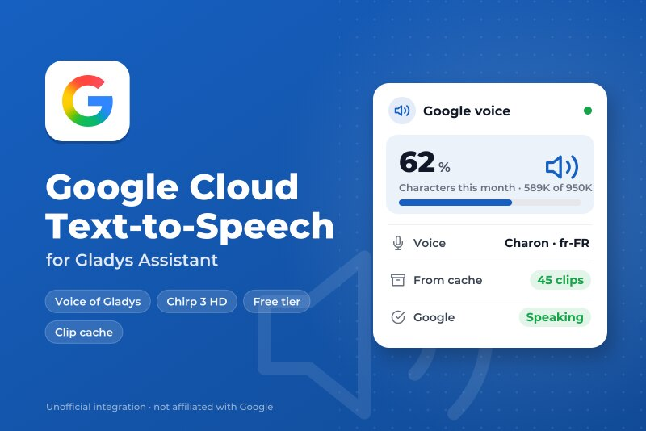
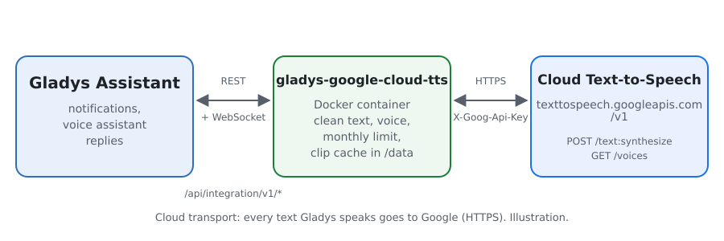
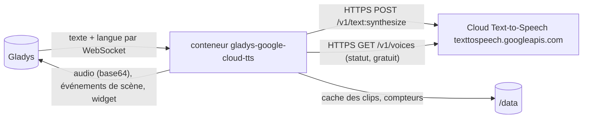
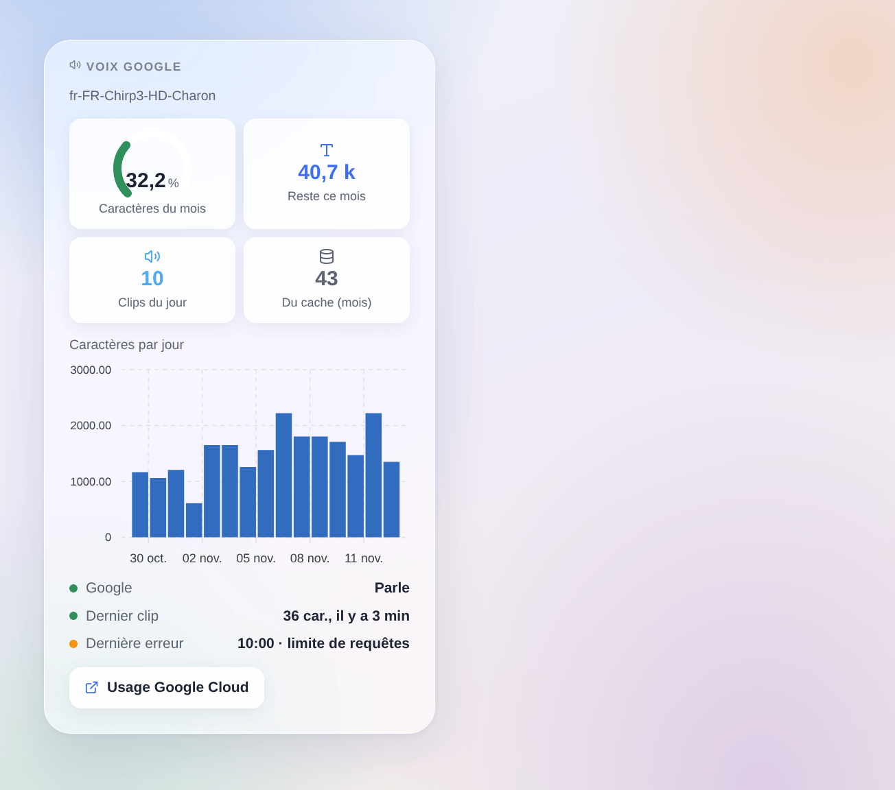

# Gladys Google Cloud Text-to-Speech

[English](README.md) · **Français** · [Deutsch](README.de.md) · [Español](README.es.md)

[](LICENSE)
[](https://github.com/William-De71/gladys-google-cloud-tts/releases)
[](https://github.com/William-De71/gladys-google-cloud-tts/actions/workflows/release.yml)
[](https://gladysassistant.com)



Intégration externe pour [Gladys Assistant](https://gladysassistant.com) qui donne à Gladys une **voix Google Cloud** — Chirp 3 HD, Neural2, WaveNet… — via l’API officielle Cloud Text-to-Speech et votre propre clé d’API. Une fois choisie comme voix dans Paramètres → Intelligence artificielle, elle prononce les notifications des scènes sur vos enceintes et les réponses de l’assistant vocal, dans la langue de chaque utilisateur, sous un plafond mensuel de caractères qui vous garde dans la franchise gratuite par défaut.

Documentation utilisateur : [English](docs/en.md) · [Français](docs/fr.md) · [Deutsch](docs/de.md) · [Español](docs/es.md).

Non affiliée à Google. **Pas encore testée avec une vraie clé Google Cloud** : les requêtes suivent la référence officielle de l’API, et les tests tournent contre une fausse API. Vos retours sont les bienvenus.

## Fonctionnalités

- **Fournisseur TTS** (`type: "tts"`, Gladys 5.3+) : l’action de scène « jouer une notification » et l’assistant vocal parlent avec une voix Google.
- **Une voix par langue** : Gladys donne la langue de l’utilisateur ; l’intégration choisit une voix de la famille (Chirp 3 HD, Neural2, WaveNet, Standard, Studio, Polyglot) et du genre choisis, toujours la même — ou la voix saisie par son nom pour cette langue.
- **Réglages du son** : vitesse, hauteur, gain de volume, profil d’appareil (enceinte, hi-fi, casque…), MP3, Ogg Opus ou WAV.
- **Coûts maîtrisés** : un plafond mensuel de caractères (95 % de la franchise gratuite par défaut), vérifié avant chaque clip ; un cache des clips (300 clips) pour qu’une phrase déjà prononcée ne soit jamais refacturée ; Markdown et emoji retirés avant l’envoi.
- **Déclencheurs de scène** : la parole échoue (clé refusée, API ou facturation non activée, voix inconnue, API injoignable), parle de nouveau, et 80 % / 100 % du plafond mensuel.
- **Widget de tableau de bord** : caractères du mois face au plafond, clips du jour et du cache, caractères par jour, dernier clip et dernière erreur.
- Boutons **Tester la voix**, **Lister les voix** et **Vider le cache des clips**. Anglais, français, allemand et espagnol.

## Fonctionnement





Une notification, de la scène à l’enceinte :

```mermaid
sequenceDiagram
  participant S as Scène
  participant G as Gladys
  participant I as Intégration
  participant T as Google
  S->>G: jouer une notification « La porte du garage est ouverte »
  G->>I: synthesize(texte, "fr")
  I->>I: nettoie le texte, choisit fr-FR-Chirp3-HD-Achernar
  alt déjà prononcée avec les mêmes réglages
    I->>I: lit le cache des clips (rien de facturé)
  else nouvelle phrase, sous le plafond mensuel
    I->>T: text:synthesize (voix, réglages audio)
    T-->>I: MP3 (base64)
    I->>I: compte les caractères, garde le clip
  end
  I-->>G: audio/mpeg;base64,…
  G->>G: sert le clip sur une URL locale à usage unique
  G->>S: l’enceinte le joue
```

Gladys coupe un texte à 2 000 caractères et attend le clip 30 s ; l’intégration donne 25 s à Google, réessaie un 429 ou un 5xx dans ce délai, et garde chaque requête sous les 5 000 octets acceptés par Google. Une panne n’est jamais masquée : l’action de scène échoue visiblement, et l’assistant vocal répond par écrit.

### Transport

`transports: ["cloud"]` : tout part vers `texttospeech.googleapis.com` en HTTPS, la clé dans l’en-tête `X-Goog-Api-Key`. **Google reçoit chaque texte que Gladys lit à voix haute** (notifications, réponses de l’assistant). `/data` garde les compteurs et le cache des clips (300 clips, 40 Mo au plus) ; rien d’autre ne sort du conteneur.

## Voix

| Famille    | Offert chaque mois         | Ensuite, le million | Remarques                                       |
| ---------- | -------------------------- | ------------------- | ----------------------------------------------- |
| Chirp 3 HD | 1 million                  | 30 $                | Par défaut : la plus naturelle ; pas de hauteur |
| Neural2    | 1 million (avec Polyglot)  | 16 $                | Naturelle, de nombreuses langues                |
| WaveNet    | 4 millions (avec Standard) | 4 $                 | Bonne, presque toutes les langues               |
| Standard   | 4 millions (avec WaveNet)  | 4 $                 | Robotique, toutes les langues                   |
| Studio     | 1 million                  | 160 $               | Narration, quelques langues ; pas de hauteur    |
| Polyglot   | 1 million (avec Neural2)   | 16 $                | Préversion, quelques langues                    |

Tarifs vérifiés sur cloud.google.com/text-to-speech/pricing le 9 novembre 2026 ; les voix Gemini-TTS (facturées au jeton, sans franchise) ne sont pas proposées. Si la famille n’a pas de voix pour une langue, Chirp 3 HD, Neural2, WaveNet puis Standard sont essayées, et l’écran de configuration le signale.

## Scènes et widget



- **Déclencheur « Voix Google : la parole est en erreur »** : variables `kind` (`auth`, `disabled`, `billing`, `voice`, `rate_limit`, `unreachable`, `timeout`, `server`), `message`, `voice`, `language` ; filtre par type. Une fois par panne. Un texte refusé à lui seul et le plafond du mois ne déclenchent rien ici.
- **Déclencheur « Voix Google : parle de nouveau »** : variable `down_minutes`.
- **Déclencheur « Voix Google : plafond du mois »** : variables `level` (`warning` à 80 %, `reached` quand un clip est refusé), `used`, `limit`, `percent`, `month` ; une fois par niveau et par mois de facturation.
- **Widget « Voix Google »** : compté par l’intégration ; la même clé utilisée ailleurs n’y figure pas. La console Google Cloud reste la référence pour la facture.
- **Pas d’action de scène** : l’audio est joué par Gladys elle-même (« jouer une notification ») ; un clip n’est pas une sortie qu’une scène pourrait utiliser.

Exemples :

- _Quand la parole échoue_ (type `billing`) → envoyer un message Telegram à l’administrateur avec `{{triggerEvent.data.message}}`.
- _Quand le plafond mensuel atteint 80 %_ → envoyer un e-mail « Voix Google : `{{triggerEvent.data.percent}}` % du mois utilisés ».

## Prérequis

- Gladys Assistant **5.3.0** ou plus récent (fournisseurs TTS) ; les instances plus anciennes ne peuvent pas installer l’intégration.
- Un projet Google Cloud avec la facturation activée, l’API Cloud Text-to-Speech activée et une clé d’API restreinte à cette API.

### Coûts et limites

- **Facturation au caractère**, espaces compris, par mois calendaire du compte de facturation (heure du Pacifique). Google exige un compte de facturation même dans la franchise gratuite.
- **Le plafond mensuel** de l’intégration vaut par défaut 95 % de la franchise gratuite de la famille choisie (950 000 caractères pour Chirp 3 HD). Il ne compte que ce que cette intégration envoie : si le même projet parle ailleurs, baissez-le, ou posez une alerte de budget dans la console Google Cloud.
- **Limites de requêtes** : 200 par minute pour Chirp 3 HD, 1 000 pour les autres — bien au-delà des besoins d’une maison.

## Installation

- **Depuis le store** : Intégrations → Google Cloud Text-to-Speech → Installer.
- **Depuis l’URL du dépôt** : Intégrations → intégration externe → `https://github.com/William-De71/gladys-google-cloud-tts`.
- **Mode développeur** : lancez `npm start` avec les variables données par Gladys (voir Développement).

## Configuration

| Champ ou bouton          | Par défaut  | Rôle                                                                                |
| ------------------------ | ----------- | ----------------------------------------------------------------------------------- |
| Clé d’API                | —           | Obligatoire, un secret : jamais réaffichée, jamais journalisée                      |
| Famille de voix          | Chirp 3 HD  | Voir Voix                                                                           |
| Genre de la voix         | Féminine    | La voix choisie dans la famille, pour chaque langue                                 |
| Voix par nom             | —           | Facultatif, une par langue, séparées par des virgules : `fr-FR-Chirp3-HD-Charon, …` |
| Langue si inconnue       | Anglais     | Quand Gladys ne précise pas la langue                                               |
| Vitesse, hauteur, gain   | 1×, 0, 0 dB | Listes ; Chirp 3 HD et Studio ignorent la hauteur                                   |
| Optimisée pour           | —           | Profil audio Google de l’appareil qui joue la voix                                  |
| Format audio             | MP3         | MP3, Ogg Opus ou WAV (5 Mo au plus : textes courts)                                 |
| Plafond mensuel          | 0           | Caractères par mois ; 0 = 95 % de la franchise gratuite de la famille               |
| Tester la voix           | —           | Prononce une courte phrase, affiche la voix, le temps et le mois                    |
| Lister les voix          | —           | Les voix de la famille pour une langue (gratuit)                                    |
| Vider le cache des clips | —           | Oublie les phrases déjà prononcées                                                  |

## Utilisation

1. Dans Gladys (Intégrations → Google Cloud Text-to-Speech → Configuration) : collez la clé d’API, choisissez la famille et le genre ; appuyez sur **Tester la voix**.
2. Paramètres → **Intelligence artificielle**, carte **Voix** : choisissez **Google Cloud Text-to-Speech**.
3. Utilisez « jouer une notification » dans vos scènes ; ajoutez le widget à un tableau de bord ; utilisez les déclencheurs.

## Développement

```bash
npm install
npm test                       # node --test, une fausse API Google sur 127.0.0.1, jamais le réseau
npm run lint                   # ESLint
npm run format:check           # Prettier
npx github:GladysAssistant/integration-store . --skip-image-check
scripts/build-cover.sh         # cover.jpg depuis docs/assets/cover.svg
docs/illustrations/render.sh   # docs/assets/widgets.<lang>.png
```

En local, le SDK lit `GLADYS_HOST_API_URL`, `GLADYS_INTEGRATION_TOKEN` et `GLADYS_INTEGRATION_SELECTOR` (donnés par Gladys en mode développeur), et l’intégration lit `TZ`. `DEBUG=gladys-integration-sdk` affiche les journaux du SDK.

Les tests couvrent le client HTTP (types d’erreur depuis l’`ErrorInfo` de Google, nouvelles tentatives, délais, clés masquées), le nettoyage du texte et la coupe à 5 000 octets, le choix de la voix, le cache des clips, le plafond mensuel et son mois de facturation, les déclencheurs, le widget (`validateWidgetContent`), le manifeste, les quatre langues, le script de release, et toute l’intégration contre le faux Gladys du SDK. `test/structure.test.js` fige chaque clé stockée par les utilisateurs.

## Processus de release


Chaque fusion sur `main` lance la CI, puis calcule la version depuis les [Conventional Commits](https://www.conventionalcommits.org/) depuis le dernier tag : `feat` → mineure, `fix` / `perf` → correctif, `!` ou `BREAKING CHANGE` → majeure (une mineure sous 1.0.0) ; `docs`, `chore`, `ci`, `test`, `style`, `refactor`, `build` seuls ne publient rien. La section du changelog est générée, le tag poussé, l’image multi-architecture construite, puis `main` reçoit le commit de release, la GitHub Release est créée et un dernier job vérifie l’image publique, le validateur du store et le topic.

- Le titre de la pull request devient le commit squash, puis la ligne du changelog : écrivez-le en anglais, pour l’utilisateur (`pr-title.yml` le vérifie). N’éditez jamais `CHANGELOG.md` à la main.
- 1.0.0 est une décision : Actions → Release → Run workflow avec `release-as: 1.0.0`. `dry-run` montre la version et les notes sans rien publier.
- **Branche protégée** : des rulesets imposent une pull request sur `main` et verrouillent les tags `v*` ; seuls le mainteneur et les deploy keys passent. La release pousse avec la deploy key de l’environnement `release` (secret `RELEASE_DEPLOY_KEY`, `main` seulement) : un run lancé depuis une autre branche ne l’obtient jamais. `build.yml` et `github-release.yml` ne démarrent pas sur un tag : la release les appelle, ou lancez-les à la main (Actions → Run workflow, avec `version` pour l’image) pour terminer une release.
- Après la première release, rendez public le package `ghcr.io` (Package settings → Change visibility), sinon Gladys ne peut pas le télécharger.

## Dépannage

Voir [docs/fr.md](docs/fr.md#dépannage). Signalez les problèmes avec les versions de Gladys et de l’intégration, la famille de voix, le format audio, l’enceinte et le message de **Tester la voix**. Ne collez jamais votre clé d’API.

## Contribuer

Issues et pull requests bienvenues, surtout de la part de personnes qui ont une clé Google Cloud : une requête qui échoue (sans la clé) aide beaucoup. Lancez `npm run format:check && npm run lint && npm test` avant d’ouvrir une pull request, et ne changez aucune clé stockée (voir [CLAUDE.md](CLAUDE.md)).

## Sécurité

Voir [SECURITY.md](SECURITY.md) : signalez les vulnérabilités en privé. La clé d’API est un champ `secret` : jamais journalisée, jamais écrite dans `/data`, envoyée uniquement à `texttospeech.googleapis.com` en HTTPS, dans un en-tête ; une clé citée dans un message d’erreur est masquée.

## Captures à venir

Les images ci-dessus sont des illustrations, pas des captures. Les vraies captures iront dans `docs/assets/screenshots/` (PNG, 1280 × 800) : `configuration.png` (la configuration avec son statut et le résultat de Tester la voix), `ai-settings.png` (Google Cloud Text-to-Speech choisie dans la carte Voix de Paramètres → Intelligence artificielle), `scene.png` (une scène « jouer une notification »).

## Licence

[Licence Apache 2.0](LICENSE) — voir aussi [NOTICE](NOTICE). Google, Google Cloud et le logo Google sont des marques de Google LLC ; ce projet n’est ni affilié à Google, ni approuvé ou sponsorisé par Google. Merci à la documentation et au SDK de Gladys, et à la documentation de Cloud Text-to-Speech.
