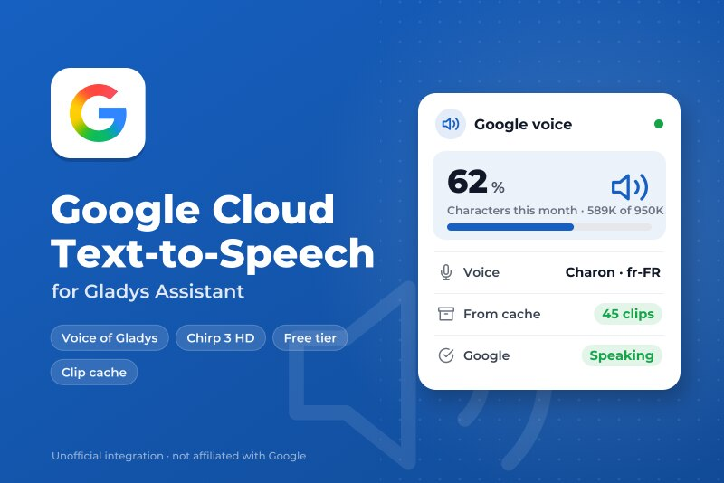
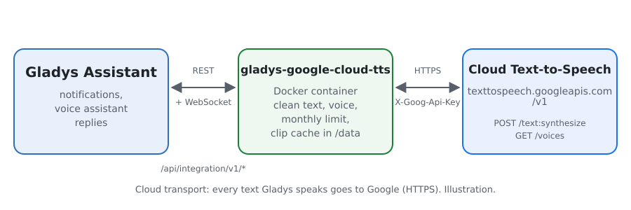
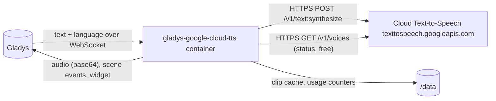
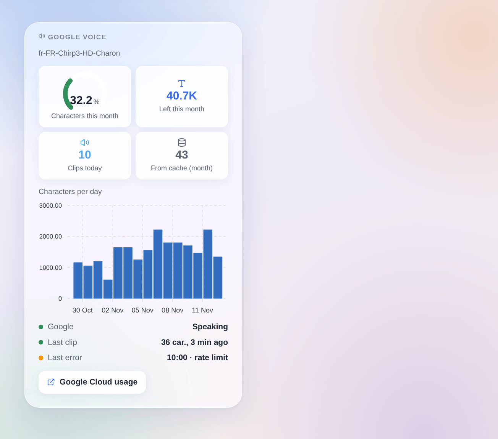

# Gladys Google Cloud Text-to-Speech

**English** · [Français](README.fr.md) · [Deutsch](README.de.md) · [Español](README.es.md)

[](LICENSE)
[](https://github.com/William-De71/gladys-google-cloud-tts/releases)
[](https://github.com/William-De71/gladys-google-cloud-tts/actions/workflows/release.yml)
[](https://gladysassistant.com)



[Gladys Assistant](https://gladysassistant.com) external integration that gives Gladys a **Google Cloud voice** — Chirp 3 HD, Neural2, WaveNet… — through the official Cloud Text-to-Speech API and your own API key. Once selected as the voice in Settings → Artificial Intelligence, it speaks the scene notifications on your speakers and the replies of the voice assistant, in the language of each user, within a monthly character limit that keeps you in the free allowance by default.

User documentation: [English](docs/en.md) · [Français](docs/fr.md) · [Deutsch](docs/de.md) · [Español](docs/es.md).

Not affiliated with Google. **Not tested with a real Google Cloud key yet**: the requests follow the official API reference, and the tests run against a fake API. Feedback welcome.

## Features

- **TTS provider** (`type: "tts"`, Gladys 5.3+): the "play a notification" scene action and the voice assistant speak with a Google voice.
- **Voice per language**: Gladys gives the language of the user; the integration picks a voice of the chosen family (Chirp 3 HD, Neural2, WaveNet, Standard, Studio, Polyglot) and gender, always the same — or the voice you typed by name for that language.
- **Sound settings**: speed, pitch, volume gain, device profile (speaker, hi-fi, headphones…), MP3, Ogg Opus or WAV.
- **Costs under control**: a monthly character limit (95 % of the free allowance by default), checked before every clip; a clip cache (300 clips) so a sentence already spoken is never billed again; Markdown and emoji removed before sending.
- **Scene triggers**: speech fails (key refused, API or billing not enabled, voice unknown, API unreachable), speaks again, and 80 % / 100 % of the monthly limit.
- **Dashboard widget**: characters of the month against the limit, clips of the day and from the cache, characters per day, last clip and last error.
- **Test the voice**, **List the voices** and **Empty the clip cache** buttons. English, French, German and Spanish.

## How it works





A notification, from the scene to the speaker:

```mermaid
sequenceDiagram
  participant S as Scene
  participant G as Gladys
  participant I as Integration
  participant T as Google
  S->>G: play a notification "The garage door is open"
  G->>I: synthesize(text, "fr")
  I->>I: clean the text, pick fr-FR-Chirp3-HD-Achernar
  alt already spoken with the same settings
    I->>I: read the clip cache (nothing billed)
  else new sentence, under the monthly limit
    I->>T: text:synthesize (voice, audio config)
    T-->>I: MP3 (base64)
    I->>I: count the characters, keep the clip
  end
  I-->>G: audio/mpeg;base64,…
  G->>G: serve the clip on a one-time LAN URL
  G->>S: the speaker plays it
```

Gladys cuts a text at 2,000 characters and waits 30 s for the clip; the integration gives Google 25 s, retries a 429 or a 5xx within that time, and keeps every request under the 5,000 bytes Google accepts. A failure is never hidden: the scene action fails visibly, and the voice assistant answers in text.

### Transport

`transports: ["cloud"]`: everything goes to `texttospeech.googleapis.com` over HTTPS, the key in the `X-Goog-Api-Key` header. **Google receives every text Gladys reads aloud** (notifications, replies of the assistant). `/data` keeps the usage counters and the clip cache (300 clips, 40 MB at most); nothing else leaves the container.

## Voices

| Family     | Free each month           | Then, per 1M characters | Notes                                |
| ---------- | ------------------------- | ----------------------- | ------------------------------------ |
| Chirp 3 HD | 1 million                 | $30                     | Default: the most natural; no pitch  |
| Neural2    | 1 million (with Polyglot) | $16                     | Natural, many languages              |
| WaveNet    | 4 million (with Standard) | $4                      | Good, almost every language          |
| Standard   | 4 million (with WaveNet)  | $4                      | Robotic, every language              |
| Studio     | 1 million                 | $160                    | Narration, a few languages; no pitch |
| Polyglot   | 1 million (with Neural2)  | $16                     | Preview, a few languages             |

Prices checked on cloud.google.com/text-to-speech/pricing on 9 November 2026; Gemini-TTS voices (billed per token, no free allowance) are not offered. When the family has no voice for a language, Chirp 3 HD, Neural2, WaveNet then Standard are tried, and the configuration screen says so.

## Scenes and widget



- **Trigger "Google voice: speech fails"**: variables `kind` (`auth`, `disabled`, `billing`, `voice`, `rate_limit`, `unreachable`, `timeout`, `server`), `message`, `voice`, `language`; filter by kind. Once per failure. A text refused on its own and the monthly limit start nothing here.
- **Trigger "Google voice: speaks again"**: variable `down_minutes`.
- **Trigger "Google voice: monthly limit"**: variables `level` (`warning` at 80 %, `reached` when a clip is refused), `used`, `limit`, `percent`, `month`; once per level and billing month.
- **Widget "Google voice"**: counted by the integration; the same key used elsewhere is not in it. The Google Cloud console stays the reference for the bill.
- **No scene action**: the audio is played by Gladys itself ("play a notification"); a clip is not an output a scene could use.

Examples:

- _When speech fails_ (kind `billing`) → send a Telegram message to the administrator with `{{triggerEvent.data.message}}`.
- _When the monthly limit reaches 80 %_ → send an e-mail "Google voice: `{{triggerEvent.data.percent}}` % of the month used".

## Requirements

- Gladys Assistant **5.3.0** or later (TTS providers); older instances cannot install the integration.
- A Google Cloud project with billing enabled, the Cloud Text-to-Speech API enabled, and an API key restricted to that API.

### Costs and limits

- **Billed per character**, spaces included, per calendar month of the billing account (Pacific time). Google requires a billing account even within the free allowance.
- **The monthly limit** of the integration is 95 % of the free allowance of the chosen family by default (950,000 characters for Chirp 3 HD). It only counts what this integration sends: if the same project speaks elsewhere, lower it, or set a budget alert in the Google Cloud console.
- **Rate limits**: 200 requests a minute for Chirp 3 HD, 1,000 for the others — far above what a home needs.

## Installation

- **From the store**: Integrations → Google Cloud Text-to-Speech → Install.
- **From the repository URL**: Integrations → external integration → `https://github.com/William-De71/gladys-google-cloud-tts`.
- **Developer mode**: run `npm start` with the variables given by Gladys (see Development).

## Configuration

| Field or button       | Default     | Meaning                                                                  |
| --------------------- | ----------- | ------------------------------------------------------------------------ |
| API key               | —           | Required, a secret: never shown again, never logged                      |
| Voice family          | Chirp 3 HD  | See Voices                                                               |
| Voice gender          | Female      | The voice picked in the family, for each language                        |
| Voices by name        | —           | Optional, one per language, comma-separated: `fr-FR-Chirp3-HD-Charon, …` |
| Language when unknown | English     | When Gladys does not say the language                                    |
| Speed, pitch, gain    | 1×, 0, 0 dB | Selects; Chirp 3 HD and Studio ignore the pitch                          |
| Tuned for             | —           | Google audio profile of the device that plays the voice                  |
| Audio format          | MP3         | MP3, Ogg Opus or WAV (5 MB at most: short texts)                         |
| Monthly limit         | 0           | Characters a month; 0 = 95 % of the free allowance of the family         |
| Test the voice        | —           | Speaks a short sentence, shows the voice, the time and the month         |
| List the voices       | —           | The voices of the family for a language (free)                           |
| Empty the clip cache  | —           | Forgets the sentences already spoken                                     |

## Usage

1. In Gladys (Integrations → Google Cloud Text-to-Speech → Configuration): paste the API key, choose the family and the gender; press **Test the voice**.
2. Settings → **Artificial Intelligence**, **Voice** card: choose **Google Cloud Text-to-Speech**.
3. Use "play a notification" in your scenes; add the widget to a dashboard; use the triggers.

## Development

```bash
npm install
npm test                       # node --test, a fake Google API on 127.0.0.1, never the network
npm run lint                   # ESLint
npm run format:check           # Prettier
npx github:GladysAssistant/integration-store . --skip-image-check
scripts/build-cover.sh         # cover.jpg from docs/assets/cover.svg
docs/illustrations/render.sh   # docs/assets/widgets.<lang>.png
```

Locally, the SDK reads `GLADYS_HOST_API_URL`, `GLADYS_INTEGRATION_TOKEN` and `GLADYS_INTEGRATION_SELECTOR` (given by Gladys in developer mode), and the integration reads `TZ`. `DEBUG=gladys-integration-sdk` shows the SDK logs.

The tests cover the HTTP client (error kinds from the Google `ErrorInfo`, retries, deadlines, masked keys), the text cleaning and the 5,000-byte cut, the voice choice, the clip cache, the monthly limit and its billing month, the triggers, the widget (`validateWidgetContent`), the manifest, the four languages, the release script, and the whole integration against the fake Gladys of the SDK. `test/structure.test.js` freezes every key users store.

## Release process


Every merge on `main` runs the CI, then computes the version from the [Conventional Commits](https://www.conventionalcommits.org/) since the last tag: `feat` → minor, `fix` / `perf` → patch, `!` or `BREAKING CHANGE` → major (a minor below 1.0.0); `docs`, `chore`, `ci`, `test`, `style`, `refactor`, `build` alone publish nothing. The changelog section is generated, the tag pushed, the multi-architecture image built, then `main` receives the release commit, the GitHub Release is created and a last job checks the public image, the store validator and the topic.

- The pull request title becomes the squash commit, then the changelog line: write it in English, for the user (`pr-title.yml` checks it). Never edit `CHANGELOG.md` by hand.
- 1.0.0 is a decision: Actions → Release → Run workflow with `release-as: 1.0.0`. `dry-run` shows the version and the notes without publishing.
- **Protected branch**: the release pushes its commit to `main` with `GITHUB_TOKEN`. The `protect-main` ruleset (no deletion, no force-push) lets it through; a stricter rule (pull request required, status checks) would need GitHub Actions in its bypass list, or a GitHub App.
- After the first release, make the `ghcr.io` package public (Package settings → Change visibility), or Gladys cannot pull it.

## Troubleshooting

See [docs/en.md](docs/en.md#troubleshooting). Report issues with the versions of Gladys and of the integration, the voice family, the audio format, the speaker, and the message of **Test the voice**. Never paste your API key.

## Contributing

Issues and pull requests are welcome, especially from people with a Google Cloud key: a failing request (without the key) helps a lot. Run `npm run format:check && npm run lint && npm test` before opening a pull request, and keep every stored key unchanged (see [CLAUDE.md](CLAUDE.md)).

## Security

See [SECURITY.md](SECURITY.md): report vulnerabilities privately. The API key is a `secret` field: never logged, never written to `/data`, sent only to `texttospeech.googleapis.com` over HTTPS, in a header; a key quoted in an error message is masked.

## Screenshots to come

The images above are illustrations, not screenshots. Real screenshots will go in `docs/assets/screenshots/` (PNG, 1280 × 800): `configuration.png` (the configuration with its status and the result of Test the voice), `ai-settings.png` (Google Cloud Text-to-Speech chosen in the Voice card of Settings → Artificial Intelligence), `scene.png` (a "play a notification" scene).

## License

[Apache License 2.0](LICENSE) — see also [NOTICE](NOTICE). Google, Google Cloud and the Google logo are trademarks of Google LLC; this project is not affiliated with, endorsed or sponsored by Google. Thanks to the Gladys documentation and SDK, and to the Cloud Text-to-Speech documentation.
