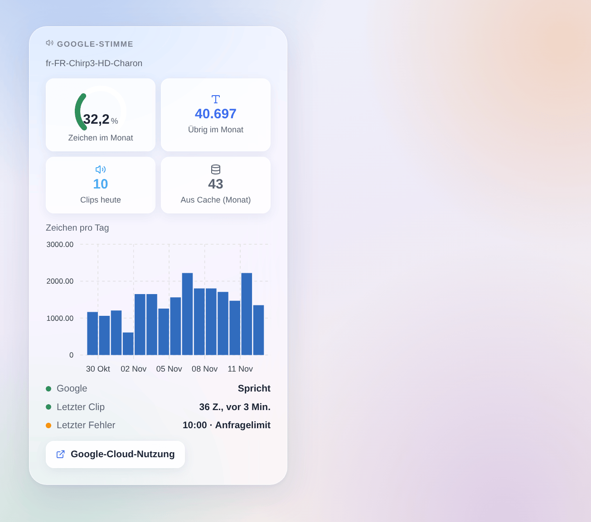

# Google Cloud Text-to-Speech

## Übersicht

Diese Integration gibt Gladys eine **Google-Cloud-Stimme** (Chirp 3 HD, Neural2, WaveNet…), über die offizielle Cloud Text-to-Speech API und deinen eigenen API-Schlüssel. Sobald du sie unter **Einstellungen → Künstliche Intelligenz** als Stimme wählst, geht alles, was Gladys sagt, über Google: die Szenenaktion „Benachrichtigung abspielen“ auf deinen Lautsprechern und die gesprochenen Antworten des Sprachassistenten. Jeder Text wird in der Sprache des Benutzers gesprochen.

Sie hält die Kosten im Griff: ein monatliches Zeichenlimit (standardmäßig 95 % des kostenlosen Kontingents) und ein Clip-Cache, damit ein schon gesprochener Satz („Das Garagentor ist offen“) nie zweimal berechnet wird. Außerdem bringt sie drei Szenenauslöser (Sprachausgabe schlägt fehl, Sprachausgabe funktioniert wieder, Monatslimit) und ein Dashboard-Widget mit.

Nicht mit Google verbunden. Noch nicht mit einem echten Google-Cloud-Schlüssel getestet: Rückmeldungen sind willkommen.

## Voraussetzungen

- Gladys Assistant 5.3.0 oder neuer.
- Ein Google-Cloud-Projekt mit **aktivierter Abrechnung** (Google verlangt ein Rechnungskonto auch innerhalb des kostenlosen Kontingents), aktivierter **Cloud Text-to-Speech API** und einem **API-Schlüssel** (APIs & Dienste → Anmeldedaten → Anmeldedaten erstellen → API-Schlüssel). Beschränke den Schlüssel auf die Cloud Text-to-Speech API.
- **Kosten**: Google berechnet jedes gesprochene Zeichen, Leerzeichen inklusive, pro Kalendermonat (pazifische Zeit). Jeden Monat kostenlos: 1 Million Zeichen für Chirp 3 HD, Neural2 und Studio, 4 Millionen für WaveNet und Standard zusammen. Darüber: 30 $, 16 $, 160 $ und 4 $ pro Million. Ein Zuhause, das 50 Benachrichtigungen pro Tag mit 60 Zeichen spricht, braucht etwa 90.000 Zeichen im Monat.
- **Deine Daten**: Jeder Text, den Gladys vorliest (Benachrichtigungen, Antworten des Assistenten), geht per HTTPS an Google.

## Konfiguration

| Feld oder Schaltfläche  | Standard          | Bedeutung                                                                                     |
| ----------------------- | ----------------- | --------------------------------------------------------------------------------------------- |
| API-Schlüssel           | —                 | Pflichtfeld. Wird nie wieder angezeigt, nie protokolliert                                     |
| Stimmenfamilie          | Chirp 3 HD        | Chirp 3 HD, Neural2, WaveNet, Standard, Studio oder Polyglot                                  |
| Geschlecht der Stimme   | Weiblich          | Die in der Familie gewählte Stimme, für jede Sprache                                          |
| Stimmen nach Name       | —                 | Optional: eine Stimme pro Sprache, durch Kommas getrennt (`de-DE-Chirp3-HD-Charon`)           |
| Sprache, wenn unbekannt | Englisch          | Wenn Gladys die Sprache des Textes nicht angibt (selten)                                      |
| Geschwindigkeit         | 1×                | Von 0,75× bis 1,5×                                                                            |
| Tonhöhe                 | 0                 | In Halbtönen, −6 bis +6; Chirp 3 HD und Studio ignorieren sie                                 |
| Lautstärkeanhebung      | 0 dB              | Von −6 bis +6 dB                                                                              |
| Optimiert für           | Nichts Bestimmtes | Google passt den Klang an das Gerät an: kleiner Lautsprecher, Smart Speaker, HiFi, Kopfhörer… |
| Audioformat             | MP3               | MP3 läuft überall; Ogg Opus klingt besser; WAV nur für kurze Texte (höchstens 5 MB)           |
| Monatslimit             | 0                 | Zeichen pro Monat; 0 = 95 % des kostenlosen Kontingents der Familie                           |
| Stimme testen           | —                 | Spricht einen kurzen Satz (etwa 60 Zeichen berechnet) und zeigt Stimme und Monat an           |
| Stimmen auflisten       | —                 | Die Stimmen der Familie für eine Sprache, um eine per Namen einzugeben (kostenlos)            |
| Clip-Cache leeren       | —                 | Vergisst die schon gesprochenen Sätze                                                         |

Der Status der Konfigurationsseite zeigt, ob Google den Schlüssel akzeptiert und eine Stimme für die Ersatzsprache hat, ohne ein Zeichen zu berechnen. Ob die Abrechnung aktiviert ist, sieht er nicht: **Stimme testen** zeigt es.

## Verwendung

1. Integrationen → **Google Cloud Text-to-Speech** → Konfiguration: Füge den API-Schlüssel ein, wähle Familie und Geschlecht, drücke **Stimme testen**.
2. Einstellungen → **Künstliche Intelligenz**, Karte **Stimme**: Wähle **Google Cloud Text-to-Speech**.
3. Füge in einer Szene die Aktion **Benachrichtigung abspielen** auf einem Lautsprecher hinzu: Gladys spricht mit der Google-Stimme. Auch der Sprachassistent antwortet damit.

### Die Stimme wählen

| Familie    | Jeden Monat kostenlos      | Danach, pro Million Zeichen | Klang                                   |
| ---------- | -------------------------- | --------------------------- | --------------------------------------- |
| Chirp 3 HD | 1 Million                  | 30 $                        | Am natürlichsten, etwa dreißig Sprachen |
| Neural2    | 1 Million (mit Polyglot)   | 16 $                        | Natürlich, viele Sprachen               |
| WaveNet    | 4 Millionen (mit Standard) | 4 $                         | Gut, fast alle Sprachen                 |
| Standard   | 4 Millionen (mit WaveNet)  | 4 $                         | Roboterhaft, alle Sprachen              |
| Studio     | 1 Million                  | 160 $                       | Erzählung, wenige Sprachen              |
| Polyglot   | 1 Million (mit Neural2)    | 16 $                        | Vorschau, wenige Sprachen               |

Preise am 9. November 2026 auf der Preisseite von Google Cloud geprüft. Für jede Sprache wählt die Integration eine Stimme der gewählten Familie und des gewählten Geschlechts in der Hauptregion der Sprache (de-DE für Deutsch), immer dieselbe. Hat die Familie keine Stimme für eine Sprache, werden Chirp 3 HD, Neural2, WaveNet und dann Standard versucht. Für eine bestimmte Stimme oder eine andere Region (de-AT, en-GB) drücke **Stimmen auflisten**, kopiere einen Namen und gib ihn unter **Stimmen nach Name** ein.

### Dashboard-Widget

Das Widget **Google-Stimme** zeigt die Zeichen des Monats im Vergleich zum Limit (Anzeige), die übrigen Zeichen, die Clips des Tages, die in diesem Monat aus dem Cache gelesenen Clips (kostenlos), die Zeichen pro Tag über 30 Tage, ob Google spricht, den letzten Clip und den letzten Fehler. Es zählt, was diese Integration gesendet hat; derselbe Schlüssel anderswo genutzt ist nicht enthalten. Die Google-Cloud-Konsole bleibt die Referenz für die Rechnung.

### Szenen

- **Auslöser „Google-Stimme: Sprachausgabe schlägt fehl“**: einmal pro Ausfall (Schlüssel abgelehnt, API nicht aktiviert, Abrechnung nicht aktiviert, Stimme unbekannt, Anfragelimit, API nicht erreichbar, zu langsam, Google-Fehler), mit Art, Meldung, Stimme und Sprache. Ein einzeln abgelehnter Text und das Monatslimit lösen hier nichts aus.
- **Auslöser „Google-Stimme: spricht wieder“**: der erste Clip nach einem Ausfall, mit den Minuten des Ausfalls.
- **Auslöser „Google-Stimme: Monatslimit“**: bei 80 % des Limits (`warning`), dann wenn ein Clip abgelehnt wird (`reached`), einmal pro Stufe und Monat, mit den verbrauchten Zeichen, dem Limit und dem Prozentsatz.

Beispiele: Wenn die Sprachausgabe fehlschlägt, schicke dem Administrator eine Telegram-Nachricht mit der Meldung; bei 80 % des Monatslimits eine E-Mail mit dem Prozentsatz; wenn das Limit erreicht ist, eine schriftliche Benachrichtigung, die nichts kostet.

Es gibt keine Szenenaktion: Das Audio spielt Gladys selbst ab, über „Benachrichtigung abspielen“.

## Fehlerbehebung

- **„Google hat den API-Schlüssel abgelehnt“**: Kopiere den Schlüssel erneut aus den Anmeldedaten; ist der Schlüssel beschränkt, müssen seine API-Einschränkungen die Cloud Text-to-Speech API enthalten.
- **„Die Cloud Text-to-Speech API ist nicht aktiviert“**: Aktiviere sie in der API-Bibliothek des Projekts des Schlüssels, warte eine Minute und drücke dann **Stimme testen**.
- **„Google verlangt die Abrechnung“**: Verknüpfe ein Rechnungskonto mit dem Projekt. Das kostenlose Kontingent gilt weiterhin.
- **„Monatliches Zeichenlimit erreicht“**: Clips werden bis zum 1. des Folgemonats (pazifische Zeit) abgelehnt; erhöhe das **Monatslimit**, um weiterzumachen (über dem kostenlosen Kontingent berechnet Google).
- **„Keine Stimme gefunden“**: Eine per Name eingegebene Stimme existiert nicht, oder keine Familie hat eine Stimme für die Sprache; drücke **Stimmen auflisten**.
- **Der Lautsprecher spielt nichts**: Wähle MP3; Ogg Opus und WAV spielt nicht jeder Lautsprecher, und ein langer Text in WAV überschreitet die 5 MB, die Gladys annimmt.
- **Ein Wort wird schlecht ausgesprochen**: Google verbessert seine Stimmen; drücke **Clip-Cache leeren**, um die neue Aussprache eines schon gesprochenen Satzes zu hören.
- Protokolle: Einstellungen → Supervision, die Protokolle der Integration. Teile niemals deinen API-Schlüssel.
