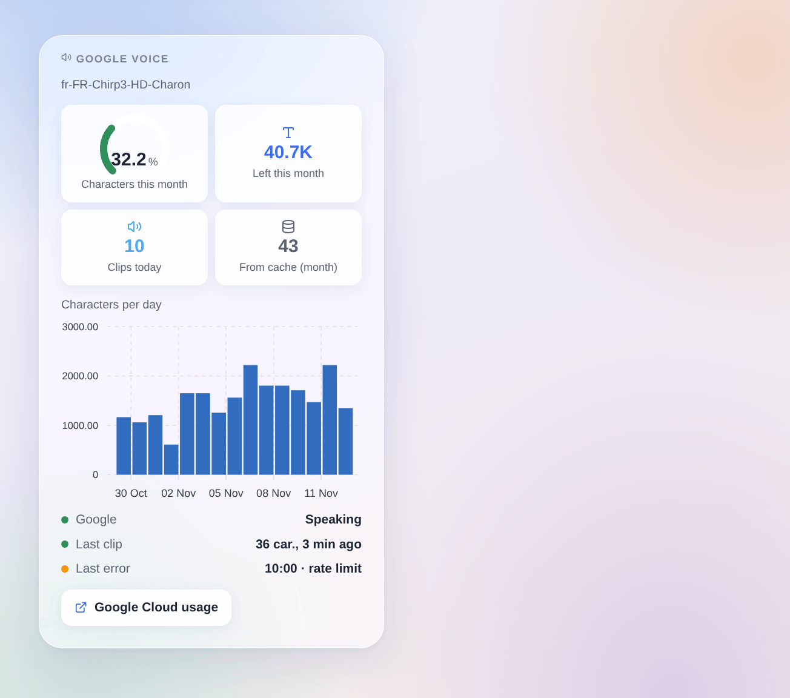

# Google Cloud Text-to-Speech

## Overview

This integration gives Gladys a **Google Cloud voice** (Chirp 3 HD, Neural2, WaveNet…), through the official Cloud Text-to-Speech API and your own API key. Once you choose it as the voice in **Settings → Artificial Intelligence**, everything Gladys says goes through Google: the "play a notification" scene action on your speakers, and the spoken replies of the voice assistant. Each text is spoken in the language of the user.

It keeps costs under control: a monthly character limit (95 % of the free allowance by default), and a clip cache so that a sentence already spoken ("The garage door is open") is never billed twice. It also adds three scene triggers (speech fails, speech works again, monthly limit) and a dashboard widget.

Not affiliated with Google. Not tested with a real Google Cloud key yet: feedback welcome.

## Prerequisites

- Gladys Assistant 5.3.0 or later.
- A Google Cloud project with **billing enabled** (Google requires a billing account even within the free allowance), the **Cloud Text-to-Speech API** enabled, and an **API key** (APIs & Services → Credentials → Create credentials → API key). Restrict the key to the Cloud Text-to-Speech API.
- **Costs**: Google bills every character spoken, spaces included, per calendar month (Pacific time). Free every month: 1 million characters for Chirp 3 HD, Neural2 and Studio, 4 million for WaveNet and Standard together. Beyond: $30, $16, $160 and $4 per million. A home that speaks 50 notifications a day of 60 characters uses about 90,000 characters a month.
- **Your data**: every text Gladys reads aloud (notifications, replies of the assistant) goes to Google over HTTPS.

## Configuration

| Field or button       | Default               | Meaning                                                                                  |
| --------------------- | --------------------- | ---------------------------------------------------------------------------------------- |
| API key               | —                     | Required. Never shown again, never logged                                                |
| Voice family          | Chirp 3 HD            | Chirp 3 HD, Neural2, WaveNet, Standard, Studio or Polyglot                               |
| Voice gender          | Female                | The voice picked in the family, for each language                                        |
| Voices by name        | —                     | Optional: one voice per language, separated by commas (`fr-FR-Chirp3-HD-Charon`)         |
| Language when unknown | English               | When Gladys does not say the language of the text (rare)                                 |
| Speed                 | 1×                    | From 0.75× to 1.5×                                                                       |
| Pitch                 | 0                     | In semitones, −6 to +6; Chirp 3 HD and Studio ignore it                                  |
| Volume gain           | 0 dB                  | From −6 to +6 dB                                                                         |
| Tuned for             | Nothing in particular | Google adjusts the sound to the device: small speaker, smart speaker, hi-fi, headphones… |
| Audio format          | MP3                   | MP3 plays everywhere; Ogg Opus sounds better; WAV only for short texts (5 MB at most)    |
| Monthly limit         | 0                     | Characters a month; 0 = 95 % of the free allowance of the family                         |
| Test the voice        | —                     | Speaks a short sentence (about 60 characters billed) and shows the voice and the month   |
| List the voices       | —                     | The voices of the family for a language, to type one by name (free)                      |
| Empty the clip cache  | —                     | Forgets the sentences already spoken                                                     |

The status of the configuration screen says whether Google accepts the key and has a voice for the fallback language, without billing a character. It cannot see whether billing is enabled: **Test the voice** does.

## Usage

1. Integrations → **Google Cloud Text-to-Speech** → Configuration: paste the API key, choose the family and the gender, press **Test the voice**.
2. Settings → **Artificial Intelligence**, **Voice** card: choose **Google Cloud Text-to-Speech**.
3. In a scene, add the action **play a notification** on a speaker: Gladys speaks with the Google voice. The voice assistant answers with it too.

### Choosing the voice

| Family     | Free each month           | Then, per million characters | Sound                                    |
| ---------- | ------------------------- | ---------------------------- | ---------------------------------------- |
| Chirp 3 HD | 1 million                 | $30                          | The most natural, about thirty languages |
| Neural2    | 1 million (with Polyglot) | $16                          | Natural, many languages                  |
| WaveNet    | 4 million (with Standard) | $4                           | Good, almost every language              |
| Standard   | 4 million (with WaveNet)  | $4                           | Robotic, every language                  |
| Studio     | 1 million                 | $160                         | Narration, a few languages               |
| Polyglot   | 1 million (with Neural2)  | $16                          | Preview, a few languages                 |

Prices checked on the Google Cloud pricing page on 9 November 2026. For each language, the integration picks a voice of the chosen family and gender in the main region of the language (fr-FR for French), always the same. When the family has no voice for a language, Chirp 3 HD, Neural2, WaveNet then Standard are tried. To choose a precise voice or another region (fr-CA, en-GB), press **List the voices**, copy a name and type it in **Voices by name**.

### Dashboard widget

The **Google voice** widget shows the characters of the month against the limit (gauge), the characters left, the clips of the day, the clips read from the cache this month (free), the characters per day over 30 days, whether Google speaks, the last clip and the last error. It counts what this integration sent; the same key used elsewhere is not in it. The Google Cloud console stays the reference for the bill.

### Scenes

- **Trigger "Google voice: speech fails"**: once per failure (key refused, API not enabled, billing not enabled, voice unknown, rate limit, API unreachable, too slow, Google error), with the kind, the message, the voice and the language. A text refused on its own and the monthly limit start nothing here.
- **Trigger "Google voice: speaks again"**: the first clip after a failure, with the minutes of failure.
- **Trigger "Google voice: monthly limit"**: at 80 % of the limit (`warning`), then when a clip is refused (`reached`), once per level and month, with the characters used, the limit and the percentage.

Examples: when speech fails, send a Telegram message to the administrator with the message; at 80 % of the monthly limit, send an e-mail with the percentage; when the limit is reached, send a text notification, which costs nothing.

There is no scene action: the audio is played by Gladys itself, through "play a notification".

## Troubleshooting

- **"Google refused the API key"**: copy the key again from Credentials; if the key is restricted, its API restrictions must include the Cloud Text-to-Speech API.
- **"The Cloud Text-to-Speech API is not enabled"**: enable it in the API Library of the project of the key, wait a minute, then press **Test the voice**.
- **"Google requires billing"**: link a billing account to the project. The free allowance still applies.
- **"Monthly character limit reached"**: clips are refused until the 1st of next month, Pacific time; raise **Monthly limit** to go on (beyond the free allowance, Google bills).
- **"No voice found"**: a voice typed by name does not exist, or no family has a voice for the language; press **List the voices**.
- **The speaker plays nothing**: choose MP3; Ogg Opus and WAV are not played by every speaker, and a long text in WAV goes over the 5 MB Gladys accepts.
- **A word is pronounced badly**: Google improves its voices; press **Empty the clip cache** to hear the new pronunciation of a sentence already spoken.
- Logs: Settings → Supervision, the logs of the integration. Never share your API key.
