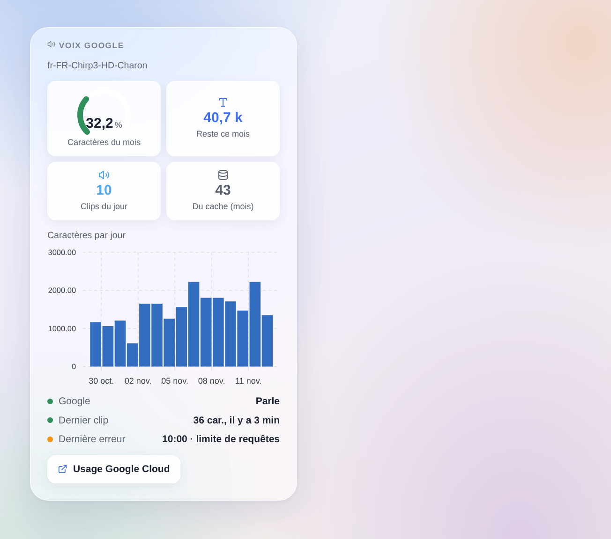

# Google Cloud Text-to-Speech

## Présentation

Cette intégration donne à Gladys une **voix Google Cloud** (Chirp 3 HD, Neural2, WaveNet…), via l’API officielle Cloud Text-to-Speech et votre propre clé d’API. Une fois choisie comme voix dans **Paramètres → Intelligence artificielle**, tout ce que dit Gladys passe par Google : l’action de scène « jouer une notification » sur vos enceintes, et les réponses parlées de l’assistant vocal. Chaque texte est prononcé dans la langue de l’utilisateur.

Elle garde les coûts sous contrôle : un plafond mensuel de caractères (95 % de la franchise gratuite par défaut), et un cache des clips pour qu’une phrase déjà prononcée (« La porte du garage est ouverte ») ne soit jamais facturée deux fois. Elle ajoute aussi trois déclencheurs de scène (la parole échoue, la parole revient, plafond du mois) et un widget de tableau de bord.

Non affiliée à Google. Pas encore testée avec une vraie clé Google Cloud : vos retours sont les bienvenus.

## Prérequis

- Gladys Assistant 5.3.0 ou plus récent.
- Un projet Google Cloud avec la **facturation activée** (Google exige un compte de facturation même dans la franchise gratuite), l’**API Cloud Text-to-Speech** activée et une **clé d’API** (API et services → Identifiants → Créer des identifiants → Clé API). Restreignez la clé à l’API Cloud Text-to-Speech.
- **Coûts** : Google facture chaque caractère prononcé, espaces compris, par mois calendaire (heure du Pacifique). Offerts chaque mois : 1 million de caractères pour Chirp 3 HD, Neural2 et Studio, 4 millions pour WaveNet et Standard à eux deux. Au-delà : 30 $, 16 $, 160 $ et 4 $ le million. Une maison qui annonce 50 notifications par jour de 60 caractères utilise environ 90 000 caractères par mois.
- **Vos données** : chaque texte que Gladys lit à voix haute (notifications, réponses de l’assistant) part chez Google en HTTPS.

## Configuration

| Champ ou bouton          | Par défaut          | Rôle                                                                                         |
| ------------------------ | ------------------- | -------------------------------------------------------------------------------------------- |
| Clé d’API                | —                   | Obligatoire. Jamais réaffichée, jamais journalisée                                           |
| Famille de voix          | Chirp 3 HD          | Chirp 3 HD, Neural2, WaveNet, Standard, Studio ou Polyglot                                   |
| Genre de la voix         | Féminine            | La voix choisie dans la famille, pour chaque langue                                          |
| Voix par nom             | —                   | Facultatif : une voix par langue, séparées par des virgules (`fr-FR-Chirp3-HD-Charon`)       |
| Langue si inconnue       | Anglais             | Quand Gladys ne précise pas la langue du texte (rare)                                        |
| Vitesse                  | 1×                  | De 0,75× à 1,5×                                                                              |
| Hauteur                  | 0                   | En demi-tons, de −6 à +6 ; Chirp 3 HD et Studio l’ignorent                                   |
| Gain de volume           | 0 dB                | De −6 à +6 dB                                                                                |
| Optimisée pour           | Rien de particulier | Google ajuste le son à l’appareil : petite enceinte, enceinte connectée, hi-fi, casque…      |
| Format audio             | MP3                 | Le MP3 passe partout ; l’Ogg Opus sonne mieux ; le WAV pour les textes courts (5 Mo au plus) |
| Plafond mensuel          | 0                   | Caractères par mois ; 0 = 95 % de la franchise gratuite de la famille                        |
| Tester la voix           | —                   | Prononce une courte phrase (environ 60 caractères facturés), affiche la voix et le mois      |
| Lister les voix          | —                   | Les voix de la famille pour une langue, pour en saisir une par son nom (gratuit)             |
| Vider le cache des clips | —                   | Oublie les phrases déjà prononcées                                                           |

Le statut de l’écran de configuration indique si Google accepte la clé et a une voix pour la langue de repli, sans facturer un caractère. Il ne voit pas si la facturation est activée : **Tester la voix** le montre.

## Utilisation

1. Intégrations → **Google Cloud Text-to-Speech** → Configuration : collez la clé d’API, choisissez la famille et le genre, appuyez sur **Tester la voix**.
2. Paramètres → **Intelligence artificielle**, carte **Voix** : choisissez **Google Cloud Text-to-Speech**.
3. Dans une scène, ajoutez l’action **jouer une notification** sur une enceinte : Gladys parle avec la voix Google. L’assistant vocal répond aussi avec elle.

### Choisir la voix

| Famille    | Offert chaque mois         | Ensuite, le million de caractères | Rendu                                       |
| ---------- | -------------------------- | --------------------------------- | ------------------------------------------- |
| Chirp 3 HD | 1 million                  | 30 $                              | La plus naturelle, une trentaine de langues |
| Neural2    | 1 million (avec Polyglot)  | 16 $                              | Naturelle, de nombreuses langues            |
| WaveNet    | 4 millions (avec Standard) | 4 $                               | Bonne, presque toutes les langues           |
| Standard   | 4 millions (avec WaveNet)  | 4 $                               | Robotique, toutes les langues               |
| Studio     | 1 million                  | 160 $                             | Narration, quelques langues                 |
| Polyglot   | 1 million (avec Neural2)   | 16 $                              | Préversion, quelques langues                |

Tarifs vérifiés sur la page des prix Google Cloud le 9 novembre 2026. Pour chaque langue, l’intégration choisit une voix de la famille et du genre choisis dans la région principale de la langue (fr-FR pour le français), toujours la même. Si la famille n’a pas de voix pour une langue, Chirp 3 HD, Neural2, WaveNet puis Standard sont essayées. Pour une voix précise ou une autre région (fr-CA, en-GB), appuyez sur **Lister les voix**, copiez un nom et saisissez-le dans **Voix par nom**.

### Widget de tableau de bord

Le widget **Voix Google** affiche les caractères du mois face au plafond (jauge), les caractères restants, les clips du jour, les clips lus depuis le cache ce mois-ci (gratuits), les caractères par jour sur 30 jours, si Google parle, le dernier clip et la dernière erreur. Il compte ce que cette intégration a envoyé ; la même clé utilisée ailleurs n’y figure pas. La console Google Cloud reste la référence pour la facture.

### Scènes

- **Déclencheur « Voix Google : la parole est en erreur »** : une fois par panne (clé refusée, API non activée, facturation non activée, voix inconnue, limite de requêtes, API injoignable, trop lent, erreur Google), avec le type, le message, la voix et la langue. Un texte refusé à lui seul et le plafond du mois ne déclenchent rien ici.
- **Déclencheur « Voix Google : parle de nouveau »** : le premier clip après une panne, avec les minutes de panne.
- **Déclencheur « Voix Google : plafond du mois »** : à 80 % du plafond (`warning`), puis quand un clip est refusé (`reached`), une fois par niveau et par mois, avec les caractères utilisés, le plafond et le pourcentage.

Exemples : quand la parole échoue, envoyer un message Telegram à l’administrateur avec le message ; à 80 % du plafond mensuel, envoyer un e-mail avec le pourcentage ; quand le plafond est atteint, envoyer une notification écrite, qui ne coûte rien.

Il n’y a pas d’action de scène : l’audio est joué par Gladys elle-même, via « jouer une notification ».

## Dépannage

- **« Google a refusé la clé d’API »** : recopiez la clé depuis Identifiants ; si la clé est restreinte, ses restrictions d’API doivent inclure l’API Cloud Text-to-Speech.
- **« L’API Cloud Text-to-Speech n’est pas activée »** : activez-la dans la bibliothèque d’API du projet de la clé, attendez une minute, puis appuyez sur **Tester la voix**.
- **« Google exige la facturation »** : associez un compte de facturation au projet. La franchise gratuite s’applique toujours.
- **« Plafond mensuel de caractères atteint »** : les clips sont refusés jusqu’au 1er du mois suivant, heure du Pacifique ; relevez le **Plafond mensuel** pour continuer (au-delà de la franchise, Google facture).
- **« Aucune voix trouvée »** : une voix saisie par nom n’existe pas, ou aucune famille n’a de voix pour la langue ; appuyez sur **Lister les voix**.
- **L’enceinte ne joue rien** : choisissez le MP3 ; l’Ogg Opus et le WAV ne sont pas lus par toutes les enceintes, et un long texte en WAV dépasse les 5 Mo acceptés par Gladys.
- **Un mot est mal prononcé** : Google améliore ses voix ; appuyez sur **Vider le cache des clips** pour entendre la nouvelle prononciation d’une phrase déjà prononcée.
- Journaux : Paramètres → Supervision, les journaux de l’intégration. Ne partagez jamais votre clé d’API.
